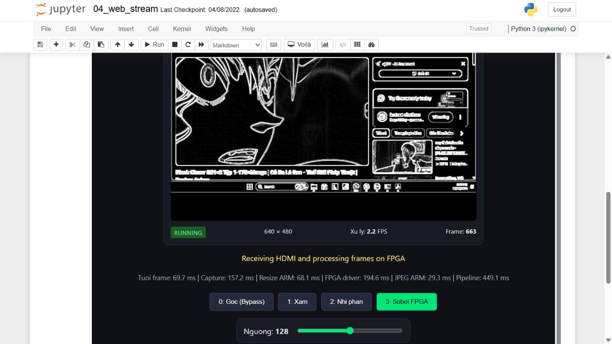

# PYNQ-Z2 FPGA Video Processing

**HDMI input → FPGA filters → Jupyter / Web**  
**Author: Tran Minh Duc (Xavier)** · [MIT](LICENSE) · **English below**



## Tiếng Việt

Dự án xử lý ảnh HDMI trên **PYNQ-Z2 / Zynq-7020** bằng bộ lọc **Verilog**. Laptop phát hình vào HDMI IN; phần ARM thu ảnh, đổi kích thước và đóng gói dữ liệu; FPGA thực hiện bộ lọc; kết quả được nén JPEG và hiển thị trên web/Jupyter.

| Chế độ | Xử lý trong custom IP FPGA |
|---|---|
| 0 — Ảnh gốc / Bypass | Chuyển tiếp pixel qua IP |
| 1 — Ảnh xám | Tính grayscale số nguyên |
| 2 — Nhị phân | Grayscale và so với ngưỡng |
| 3 — Sobel | Sobel 3×3, độ lớn `abs(Gx)+abs(Gy)`, bão hòa 255 |

**Cả bốn chế độ đều đi qua AXI DMA → custom FPGA IP → AXI DMA.** Resize, đóng gói, JPEG và HTTP chạy trên ARM. Đây là kiến trúc qua DDR, chưa phải đường lọc HDMI thuần PL.

### Kết quả đã kiểm chứng

- HDMI IN **1280×720 @ 60 Hz**; ảnh xử lý **640×480**, giữ tỷ lệ và thêm viền đen.
- **40 frame qua bốn chế độ khớp từng byte** với tham chiếu phần mềm.
- Phiên stream đầu được quan sát đến **2.143 frame hoàn tất**; thử dừng, mở lại và Run All dùng lại đúng tiến trình.
- Lần theo dõi sau sửa: **25 mẫu / 128,45 giây**, frame tăng 114 → 399, Jupyter HTTP 200 ở cả 25 mẫu; Sobel khoảng **2,22 JPEG FPS**.
- Mô phỏng RTL trước đó: **101 đối chiếu + 21 kiểm tra giao thức/lỗi/reset**. Kết quả mô phỏng và kết quả board được lưu riêng.
- Bộ nguồn công khai đã qua **57 kiểm thử host và compile 18 cell notebook** trên PC; CI GitHub sẽ chạy riêng sau khi đăng.

**60 Hz của nguồn HDMI không phải 60 FPS xử lý.** HDMI OUT chưa được kiểm chứng bằng màn hình ngoài trong phiên nghiệm thu này. Lỗi EXT4 đã ghi nhận vẫn chưa được sửa; các kết quả trên là bằng chứng của những phiên thử có giới hạn.

### Bắt đầu

1. Chuẩn bị PYNQ-Z2 chạy image PYNQ phù hợp, nguồn đúng thông số, microSD, Ethernet và nguồn HDMI 720p60. Runtime đã thử là **PYNQ 3.1.1**; nguồn hierarchy HDMI được pin từ **PYNQ v3.0.1**.
2. Theo [hướng dẫn cài và chạy](docs/GETTING_STARTED.md) để lấy bộ triển khai có `.bit/.hwh` từ GitHub Releases khi bản phát hành đã được đăng.
3. Mở `video_demo/04_web_stream.ipynb` trên Jupyter của board → **Cell → Run All**.
4. Dùng **Dừng stream** trên trang video để dừng; chạy lại cell để mở lại.

Không chạy hai ứng dụng sử dụng FPGA đồng thời. Repo nguồn không chứa image SD, môi trường Python, toàn bộ project Vivado hoặc bản sao dữ liệu cá nhân.

### Tài liệu

- [Cài đặt, chạy và tắt board](docs/GETTING_STARTED.md)
- [Kiến trúc và phân chia ARM / FPGA](docs/ARCHITECTURE.md)
- [Lỗi đã gặp, bằng chứng, cách sửa và phần còn mở](docs/TROUBLESHOOTING.md)
- [Kiểm chứng và giới hạn của bằng chứng](docs/VALIDATION.md)
- [FPS, bottleneck và HDMI OUT](docs/PERFORMANCE.md)
- [Tái dựng phần cứng](docs/REBUILD_HARDWARE.md)
- [Nguồn tham khảo và giấy phép bên thứ ba](docs/THIRD_PARTY_NOTICES.md)

### Cấu trúc

```text
rtl/          Bộ lọc Verilog và hợp đồng thanh ghi/AXI-Stream
software/     Driver, tham chiếu, server, launcher và unit tests
notebooks/    Notebook 00–04, output đã xóa để tiện đọc/chạy lại
hardware/     Tcl, constraint, nguồn hierarchy đã trích và manifest
sim/          Testbench SystemVerilog và script chạy xsim
scripts/      Kiểm tra repo và tạo gói triển khai
docs/         Hướng dẫn, lịch sử lỗi, ảnh demo và biểu đồ
evidence/     Báo cáo kiểm chứng gọn, đã bỏ dữ liệu phiên nội bộ
```

Kiểm tra trên PC, không cần board:

```bash
python -m pip install -r requirements-dev.txt
python scripts/check_repository.py
```

Không cài lại hoặc nâng cấp hàng loạt thư viện trên board chỉ để chạy lệnh kiểm tra PC này.

## English

This project implements four **Verilog image filters on a PYNQ-Z2 / Zynq-7020**: bypass, grayscale, threshold and 3×3 Sobel. All four modes traverse the custom FPGA accelerator through AXI DMA. The ARM processor handles HDMI frame capture, aspect-preserving resize/letterboxing, pixel packing, JPEG encoding and HTTP delivery.

The demonstrated path is **HDMI IN → DDR → ARM preprocessing → AXI DMA / FPGA filter → DDR → ARM JPEG → Web**. It is not an entirely PL-resident HDMI filtering pipeline.

**Measured evidence:** 40 frames across four modes matched the software reference byte-for-byte. The first stream was observed through 2,143 completed frames. Notebook start/reuse, explicit stop and restart passed. A subsequent 128.45-second observation recorded 25 healthy samples, increasing frame counts and successful Jupyter HTTP responses throughout, with approximately **2.22 completed Sobel JPEG frames/s** at 640×480 from a 720p60 HDMI source.

**Source refresh rate is not processing throughput.** External HDMI OUT display and long-term storage reliability are not certified by this test. Previously observed EXT4 errors remain unresolved and are documented openly.

For board installation, follow [Getting started](docs/GETTING_STARTED.md). The prebuilt deployment is distributed as a Release asset rather than committed build output. Source rebuilds use Vivado/Vitis HLS 2022.2 and pinned PYNQ video sources; see [Hardware rebuild](docs/REBUILD_HARDWARE.md). The board runtime tested was PYNQ 3.1.1; upstream hardware provenance is v3.0.1.

## License and credits

Original project code and documentation: **MIT, Copyright © 2026 Tran Minh Duc**. PYNQ-derived files and Digilent components retain their own licenses and copyright notices; see [third-party notices](docs/THIRD_PARTY_NOTICES.md). Third-party video/desktop content visible inside demonstration screenshots is not relicensed as project source. The setup photo and screenshots document the experiment; the performance chart is rendered from recorded measurements.
