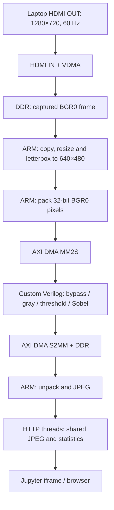

# Kiến trúc / Architecture

## ARM và FPGA làm gì?

**FPGA:** thu/phát tín hiệu video qua subsystem, DMA/VDMA và custom filter Verilog. Bốn mode đều qua custom IP; bypass cũng đi qua DMA/IP nhưng giữ nguyên pixel.

**ARM:** điều khiển subsystem, sao chép frame capture, resize nearest-neighbor, padding, đóng gói BGR0, cấu hình/thăm dò DMA, unpack, JPEG và web. Tham chiếu Python chỉ dùng so kết quả, không tự thay thế FPGA khi hardware báo lỗi.

Nguồn 1280×720 được fit thành 640×360 và thêm 60 dòng đen trên/dưới để thành 640×480. Đây là bước phần mềm có chi phí thật.

## Giao thức và clock

- Custom AXI-Stream: **32 bit/pixel `0x00RRGGBB`**, TLAST tại cuối **frame/packet**.
- Video AXI-Stream nội bộ VDMA có quy ước TLAST cuối **dòng**. Không nối thẳng hai giao thức này mà bỏ qua chuyển đổi.
- Clock custom filter: **100 MHz**. Bypass khoảng 1 cycle/pixel; gray/threshold 4; Sobel 6 cộng flush biên.
- Filter: `video_filter_0`; AXI DMA: `axi_dma_0`. Driver kiểm tra metadata HWH và hợp đồng thanh ghi trước khi chạy.
- DDR batch path dùng VDMA cho HDMI và AXI DMA riêng cho bộ lọc. Không quảng bá là pipeline Sobel trực tiếp từ chân HDMI vào tới chân HDMI ra.

## Vòng đời phần mềm

Notebook 04 xác minh hash runtime, dùng lock/PID để mở hoặc dùng lại **một** tiến trình video. Main thread của tiến trình đó sở hữu phần cứng; HTTP threads chỉ truy cập ảnh/trạng thái RAM. Nút dừng gửi yêu cầu, main thread dừng VDMA/DMA rồi trả bộ đệm.

`frame_ownership.py` là helper cục bộ cho hành vi frame cache đã kiểm tra trên board. Nó không vá toàn cục thư viện PYNQ. Trên runtime khác, cần kiểm chứng cache/buffer API thay vì mặc định tương thích.

English: all four filters execute in the custom PL accelerator, while preprocessing, control and web encoding remain on ARM. The separate server process isolates notebook lifetime; correct buffer ownership and ordered cleanup address the reproduced native crash. Isolation alone does not fix a crashing hardware process.
