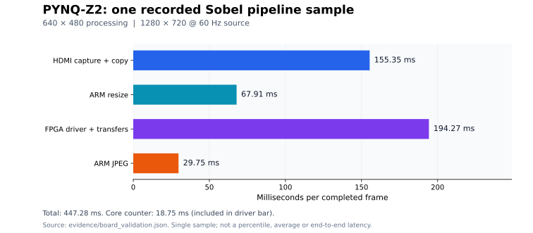

# FPS và giới hạn / Performance

## Kết quả đo

Nguồn HDMI **1280×720 @ 60 Hz**, xử lý **640×480**, mode Sobel. Báo cáo `evidence/stream_observation_128s.json` có 25 mẫu trong **128,453 giây**; frame 114 → 399. Tốc độ tính từ hai mẫu đầu/cuối: **2,2209 completed JPEG frame/s**. Thời gian giữa các mẫu là 128,328 giây, khác chút với tổng thời gian phép thử gồm yêu cầu cuối.

Biểu đồ dùng **một mẫu đã ghi** trong `evidence/board_validation.json`: capture 155,35 ms, resize 67,91 ms, FPGA driver 194,27 ms, JPEG 29,75 ms; pipeline 447,28 ms. Không trình bày mẫu này như percentile/trung bình dài hạn.

`core_active_ms ≈ 18,75 ms` nằm **bên trong** thời gian driver 194,27 ms, không cộng thêm lần nữa. Driver bao gồm đóng gói, cache, MMIO, DMA/polling và dựng lại ảnh. Counter core cũng có thể bao gồm stall; không phải phép đo số học thuần.

## Vì sao thêm HDMI OUT chưa tự thành 60 FPS?

Notebook 04 hiện không bật HDMI OUT. Một output chạy 60 Hz có thể lặp frame cuối nếu chưa có kết quả mới. Nguồn 60 Hz, số frame capture/xử lý hoàn tất và tốc độ trình duyệt hiển thị là ba đại lượng riêng. Số frame hoàn tất cũng chưa chứng minh mỗi frame có nội dung nguồn khác nhau; chưa đo frame drop bằng source frame ID.

Xuất HDMI trực tiếp có thể bỏ JPEG/HTTP nhưng vẫn còn capture, resize, sao chép, DDR và driver. Bỏ khoảng 30 ms JPEG khỏi pipeline khoảng 447 ms không đủ tạo 16,67 ms/frame cho 60 FPS.

## Hướng tối ưu chưa thực hiện trong bản này

1. Profile và giảm bản sao ảnh/đóng gói trên ARM; tái sử dụng bộ đệm và dùng phép toán native phù hợp.
2. Thử kích thước xử lý nhỏ hơn và đo lại chất lượng/FPS, giữ HDMI RX ở mode đầu vào hợp lệ.
3. Thử đường HDMI OUT riêng, đo **frame mới** và xác nhận màn hình thật; không chỉ đọc metadata refresh.
4. Thiết kế luồng xử lý streaming trong PL, đưa resize/bộ lọc vào pipeline và tối ưu throughput core nếu mục tiêu là 60 frame mới/giây.

Mô phỏng custom Sobel VGA ở 100 MHz cần 1.844.959 chu kỳ, **18,44959 ms/frame** chưa tính overhead ngoài core; cần tối ưu thêm để hướng tới 60 FPS ở kích thước này. Không hứa số FPS mới trước khi implementation và đo trên board.

English: 2.22 FPS is the measured completed-JPEG throughput of this implementation, not the board's universal hardware limit. A 60 Hz HDMI output can repeat old frames. The chart is a single recorded timing breakdown, not a long-term benchmark or end-to-end photon latency measurement.
